# Tixelise Database Architecture

## 1. Current table inventory

The current SQLite database contains **25 tables**: **18 application tables**
and **7 Django framework tables**. Application tables use the `tixelise_`
prefix. Django framework table names are unchanged.

| # | Table name | Ownership |
|---:|---|---|
| 1 | `auth_group` | Django framework |
| 2 | `auth_group_permissions` | Django framework |
| 3 | `auth_permission` | Django framework |
| 4 | `django_admin_log` | Django framework |
| 5 | `django_content_type` | Django framework |
| 6 | `django_migrations` | Django framework |
| 7 | `django_session` | Django framework |
| 8 | `tixelise_accounts_user` | Application |
| 9 | `tixelise_accounts_user_groups` | Application |
| 10 | `tixelise_accounts_user_user_permissions` | Application |
| 11 | `tixelise_assignments_staffeventassignment` | Application |
| 12 | `tixelise_assignments_staffeventassignment_allowed_categories` | Application |
| 13 | `tixelise_audit_auditlog` | Application |
| 14 | `tixelise_catalog_eventprice` | Application |
| 15 | `tixelise_catalog_ticketcategory` | Application |
| 16 | `tixelise_catalog_tickettemplate` | Application |
| 17 | `tixelise_events_event` | Application |
| 18 | `tixelise_sales_idempotencyrecord` | Application |
| 19 | `tixelise_sales_sale` | Application |
| 20 | `tixelise_sales_saleitem` | Application |
| 21 | `tixelise_staff_staffprofile` | Application |
| 22 | `tixelise_tenancy_tenant` | Application |
| 23 | `tixelise_tenancy_tenantmembership` | Application |
| 24 | `tixelise_ticketing_ticket` | Application |
| 25 | `tixelise_ticketing_ticketsequence` | Application |

This inventory reflects the checked-in database file and models as of
2026-11-03. Application tables were renamed from the former
`<app>_<model>_tixelise` form to the `tixelise_<app>_<model>` form by the
per-app `0003_*` migrations. The database configured at runtime can differ when
`DATABASE_URL` points to another database.

## 2. Database and application architecture

```text
Browser / frontend
        |
        | HTTP API requests (JSON, JWT)
        v
Django REST Framework backend
        |
        | Django ORM / migrations
        v
One configured database ("default")
  - SQLite: backend/db.sqlite3 by default
  - PostgreSQL: when DATABASE_URL is configured
        |
        +-- Application tables (18, tixelise_ prefix)
        +-- Django framework tables (7, standard names)
```

- The frontend communicates with the backend API; it does not connect directly
  to the database.
- Django models and migrations define and access application tables.
- By default, `backend/config/settings/base.py` configures one SQLite database
  at `backend/db.sqlite3`. Setting `DATABASE_URL` switches the default
  connection to the URL-configured database; the application does not create a
  separate database for each tenant.
- All tenants share the same database and tables. Tenant-owned rows are
  associated with `tixelise_tenancy_tenant` using `tenant_id`.
- Tenant identity is resolved by backend authentication and middleware from
  verified JWT claims. Tenant-aware managers scope tenant-owned model
  queries. This is application-level isolation, not a separate schema or
  database per tenant.
- Migrations change the database schema. The table-prefix migrations use
  Django model table alterations to rename application tables; they do not
  rename the Django framework tables.
- Django’s `django_migrations` table records which migrations were applied.

## 3. Entity relationship diagram

The diagram shows the principal foreign-key and many-to-many relationships.
`1` means one referenced record; `0..*` means zero or more related records.

```mermaid
erDiagram
    tixelise_tenancy_tenant ||--o{ tixelise_tenancy_tenantmembership : has
    tixelise_accounts_user ||--o{ tixelise_tenancy_tenantmembership : joins

    tixelise_tenancy_tenant ||--o{ tixelise_events_event : owns
    tixelise_tenancy_tenant ||--o{ tixelise_catalog_ticketcategory : owns
    tixelise_tenancy_tenant ||--o{ tixelise_catalog_tickettemplate : owns
    tixelise_tenancy_tenant ||--o{ tixelise_catalog_eventprice : owns
    tixelise_tenancy_tenant ||--o{ tixelise_staff_staffprofile : owns
    tixelise_tenancy_tenant ||--o{ tixelise_assignments_staffeventassignment : owns
    tixelise_tenancy_tenant ||--o{ tixelise_sales_sale : owns
    tixelise_tenancy_tenant ||--o{ tixelise_sales_idempotencyrecord : owns
    tixelise_tenancy_tenant ||--o{ tixelise_ticketing_ticket : owns
    tixelise_tenancy_tenant ||--o{ tixelise_ticketing_ticketsequence : owns
    tixelise_tenancy_tenant o|--o{ tixelise_audit_auditlog : scopes

    tixelise_accounts_user ||--o{ tixelise_staff_staffprofile : user_profile
    tixelise_accounts_user ||--o{ tixelise_events_event : created_by
    tixelise_accounts_user ||--o{ tixelise_assignments_staffeventassignment : created_by
    tixelise_accounts_user ||--o{ tixelise_sales_sale : created_by
    tixelise_accounts_user ||--o{ tixelise_sales_idempotencyrecord : actor
    tixelise_accounts_user o|--o{ tixelise_audit_auditlog : actor

    tixelise_events_event ||--o{ tixelise_catalog_eventprice : priced_by
    tixelise_catalog_ticketcategory ||--o{ tixelise_catalog_eventprice : priced_category
    tixelise_events_event ||--o{ tixelise_assignments_staffeventassignment : assigned_event
    tixelise_staff_staffprofile ||--o{ tixelise_assignments_staffeventassignment : assigned_staff
    tixelise_assignments_staffeventassignment ||--o{ tixelise_assignments_staffeventassignment_allowed_categories : category_links
    tixelise_catalog_ticketcategory ||--o{ tixelise_assignments_staffeventassignment_allowed_categories : allowed_category

    tixelise_events_event ||--o{ tixelise_sales_sale : sold_at
    tixelise_staff_staffprofile ||--o{ tixelise_sales_sale : sold_by
    tixelise_sales_sale ||--o{ tixelise_sales_saleitem : contains
    tixelise_catalog_ticketcategory ||--o{ tixelise_sales_saleitem : item_category
    tixelise_sales_sale o|--o{ tixelise_sales_idempotencyrecord : retries

    tixelise_sales_sale ||--o{ tixelise_ticketing_ticket : issues
    tixelise_events_event ||--o{ tixelise_ticketing_ticket : for_event
    tixelise_staff_staffprofile ||--o{ tixelise_ticketing_ticket : issued_by
    tixelise_catalog_ticketcategory ||--o{ tixelise_ticketing_ticket : ticket_category
    tixelise_events_event ||--o{ tixelise_ticketing_ticketsequence : sequence_for

    tixelise_accounts_user ||--o{ tixelise_accounts_user_groups : group_links
    auth_group ||--o{ tixelise_accounts_user_groups : user_group
    tixelise_accounts_user ||--o{ tixelise_accounts_user_user_permissions : permission_links
    auth_permission ||--o{ tixelise_accounts_user_user_permissions : user_permission
    auth_group ||--o{ auth_group_permissions : group_permission_links
    auth_permission ||--o{ auth_group_permissions : permission
    django_content_type ||--o{ auth_permission : defines
    tixelise_accounts_user ||--o{ django_admin_log : admin_actions
    django_content_type o|--o{ django_admin_log : logged_object_type
```



`django_session` and `django_migrations` are not connected to application
entities by foreign keys. Django sessions store session payloads, while
migration records describe applied schema changes.

## 4. Application table reference

`id` is the primary key unless specified otherwise. Columns ending in `_id`
are foreign-key columns. `NULL` means a relationship is optional.

### Tenancy and identity

| Table | Columns and relationships |
|---|---|
| `tixelise_tenancy_tenant` | `id`, `code` (unique), `name`, `status`, `timezone`, `currency`, `phone`, `settings`, `created_at`, `updated_at`. Root record for a tenant and its tenant-owned data. |
| `tixelise_accounts_user` | `id`, `password` (Django password hash), `last_login`, `is_superuser`, `username` (unique), `first_name`, `last_name`, `email`, `is_staff`, `is_active`, `date_joined`, `is_platform_admin`. Global user identity; not itself tenant-owned. |
| `tixelise_tenancy_tenantmembership` | `id`, `tenant_id` → tenant, `user_id` → user, `role`, `status`, `central_user_id`, `created_at`, `updated_at`. Unique per `(tenant_id, user_id)`. Connects users to tenants and their roles; `central_user_id` holds the linked account id in the central user master (`''` until registered). |
| `tixelise_accounts_user_groups` | `id`, `user_id` → user, `group_id` → `auth_group`. Many-to-many link between users and Django groups. |
| `tixelise_accounts_user_user_permissions` | `id`, `user_id` → user, `permission_id` → `auth_permission`. Many-to-many link between users and individual permissions. |

### Events, catalog, staff, and assignments

| Table | Columns and relationships |
|---|---|
| `tixelise_events_event` | `id`, `tenant_id` → tenant, `code`, `name`, `description`, `venue`, `address`, `start_at`, `end_at`, `sales_start_at`, `sales_end_at`, `status`, nullable `created_by_id` → user, `created_at`, `updated_at`. Unique per `(tenant_id, code)`; `end_at` must be after `start_at`. |
| `tixelise_catalog_ticketcategory` | `id`, `tenant_id` → tenant, `code`, `name`, `description`, `status`, `created_at`, `updated_at`. Unique per `(tenant_id, code)`. |
| `tixelise_catalog_eventprice` | `id`, `tenant_id` → tenant, `event_id` → event, `category_id` → ticket category, `amount`, `currency`, `effective_from`, `effective_to`, `status`, `created_at`, `updated_at`. Unique per `(tenant_id, event_id, category_id)`; `amount` must be non-negative. |
| `tixelise_catalog_tickettemplate` | `id`, `tenant_id` → tenant, `name`, `config`, `version`, `status`, `created_at`, `updated_at`. Stores tenant-specific ticket layout/configuration data. |
| `tixelise_staff_staffprofile` | `id`, `tenant_id` → tenant, `user_id` → user, `staff_code`, `display_name`, `phone`, `email`, `status`, nullable `created_by_id` → user, `created_at`, `updated_at`, `last_login`. Unique per `(tenant_id, staff_code)` and `(tenant_id, user_id)`. |
| `tixelise_assignments_staffeventassignment` | `id`, `tenant_id` → tenant, `staff_id` → staff profile, `event_id` → event, `status`, `valid_from`, `valid_until`, `restrict_categories`, nullable `created_by_id` → user, `created_at`, `updated_at`. Unique per `(tenant_id, staff_id, event_id)`. |
| `tixelise_assignments_staffeventassignment_allowed_categories` | `id`, `staffeventassignment_id` → assignment, `ticketcategory_id` → ticket category. Many-to-many list of categories allowed by an assignment. |

### Sales, tickets, and audit

| Table | Columns and relationships |
|---|---|
| `tixelise_sales_sale` | `id`, `tenant_id` → tenant, `sale_reference`, `event_id` → event, `staff_id` → staff profile, `status`, `gross_total`, `refund_total`, `currency`, nullable `created_by_id` → user, `created_at`, `updated_at`. Unique per `(tenant_id, sale_reference)`. |
| `tixelise_sales_saleitem` | `id`, `sale_id` → sale, `category_id` → ticket category, `quantity`, `unit_price_snapshot`, `line_total`. Each line belongs to a sale and captures the price at sale time. It has no direct tenant foreign key; tenant ownership is reached through its sale. |
| `tixelise_sales_idempotencyrecord` | `id`, `tenant_id` → tenant, `actor_id` → user, `idempotency_key`, `request_hash`, nullable `sale_id` → sale, `status`, `created_at`, `expires_at`. Unique per `(tenant_id, actor_id, idempotency_key)`. |
| `tixelise_ticketing_ticketsequence` | `id`, `tenant_id` → tenant, `event_id` → event, `last_number`, `updated_at`. Unique per `(tenant_id, event_id)`; stores the next ticket-number state for an event. |
| `tixelise_ticketing_ticket` | UUID `id` (primary key), `tenant_id` → tenant, `ticket_code` (unique), `event_id` → event, `staff_id` → staff profile, `sale_id` → sale, `category_id` → ticket category, `sequence_number`, `status`, `issued_at`, `reprint_count`. Unique per `(tenant_id, event_id, sequence_number)`. |
| `tixelise_audit_auditlog` | `id`, nullable `tenant_id` → tenant, nullable `actor_id` → user, `actor_label`, `action`, `target_type`, `target_id`, `correlation_id`, `metadata`, `created_at`. Nullable tenant and actor allow platform-wide events or records whose related user/tenant is removed. |

## 5. Django framework table reference

These tables are maintained by Django and keep their standard names.

| Table | Purpose and principal relationships |
|---|---|
| `auth_group` | Django permission groups. Linked to users through `tixelise_accounts_user_groups` and to permissions through `auth_group_permissions`. |
| `auth_group_permissions` | Many-to-many join table: `group_id` → `auth_group`, `permission_id` → `auth_permission`. |
| `auth_permission` | Permission definitions. `content_type_id` → `django_content_type`; linked to groups and users through their join tables. |
| `django_admin_log` | Django admin history. `user_id` → application user; nullable `content_type_id` → `django_content_type`. |
| `django_content_type` | Registry of Django application/model types; used by permissions and admin log entries. |
| `django_migrations` | Applied migration records (`app`, `name`, `applied`). It is schema history, not business data. |
| `django_session` | Server-side Django sessions (`session_key`, `session_data`, `expire_date`). No direct user foreign key. |

## 6. Relationship and tenancy notes

- **Tenant root:** `tixelise_tenancy_tenant` is the ownership root for tenant
  records. Events, catalog records, staff profiles, assignments, sales,
  idempotency records, tickets, and ticket sequences carry a `tenant_id`.
- **Membership:** `tixelise_tenancy_tenantmembership` joins a global user to a
  tenant and stores the user's tenant role and membership status. A user can
  have memberships in multiple tenants. `central_user_id` records the primary
  key of the same account in the external central user master, so the account
  can be deleted when the tenant is permanently removed.
- **Identity versus staff:** `tixelise_accounts_user` represents a login
  identity. `tixelise_staff_staffprofile` represents that user's staff role in
  a particular tenant. A user can have staff profiles in different tenants.
  Because an identity is not tenant data, deleting a tenant removes a `User`
  only when it is left with no membership anywhere and no staff profile;
  platform admins are never removed.
- **Event/catalog:** Event prices connect a tenant, event, and ticket category.
  Ticket categories can be reused across events within a tenant.
- **Assignment:** An assignment joins one staff profile to one event. Its
  category join table optionally limits which ticket categories the staff
  member may sell for that event.
- **Sale lifecycle:** A sale belongs to a tenant, event, and staff profile.
  Sale items store quantities and price snapshots. Tickets point to their
  sale, event, staff member, ticket category, and tenant.
- **Ticket numbering:** Ticket sequence rows are scoped to a `(tenant, event)`
  pair. Ticket rows enforce uniqueness for `(tenant, event, sequence_number)`.
- **Deletion behavior:** Foreign-key deletion policies are defined in Django
  models (for example `PROTECT`, `CASCADE`, and `SET_NULL`). Consult the
  corresponding model before deleting business records; do not assume every
  relationship cascades.
- **Tenant boundaries:** `tenant_id` relationships establish ownership, while
  request authentication, tenant context, and tenant-scoped queries enforce
  access boundaries. A database foreign key alone does not enforce that two
  referenced records belong to the same tenant.

## 7. Schema maintenance

Use migrations rather than manually renaming or editing database tables:

```powershell
cd backend
.venv\Scripts\python manage.py showmigrations
.venv\Scripts\python manage.py migrate
.venv\Scripts\python manage.py makemigrations --check --dry-run
```

To inspect the current SQLite table names:

```powershell
cd backend
.venv\Scripts\python manage.py shell -c "from django.db import connection; print('\n'.join(sorted(connection.introspection.table_names())))"
```

The inventory above is a point-in-time reference. When models or migrations
change, update this document and verify the live schema against the migration
state.
